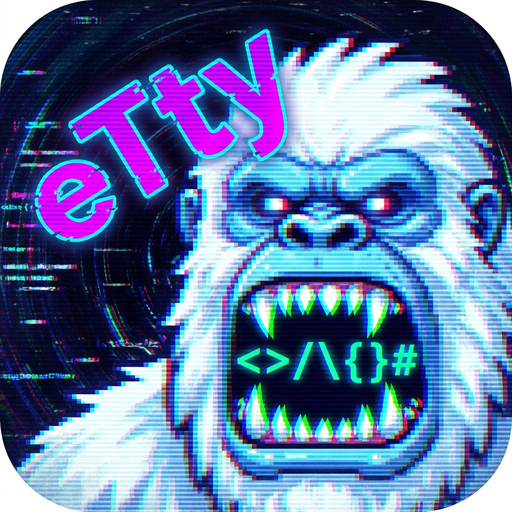

# eTty

[🇬🇧 English](README.md)

<p align="center">
  <a href="https://github.com/emaxe/eTty/releases/latest"></a>
  <a href="https://github.com/emaxe/eTty/releases"></a>
  
  
  
  <a href="https://github.com/emaxe/eTty/commits"></a>
</p>

Современный эмулятор терминала на базе Electron — дерево файлов, редактор кода, Git-интеграция и ИИ-агенты. Лёгкий, быстрый и функциональный.

<p align="center">
  
</p>

## Возможности

### Терминал

- **Несколько вкладок** с независимыми сессиями шелла (zsh на macOS/Linux; PowerShell 7 / Windows PowerShell 5.1 / Git Bash / `cmd.exe` на Windows, выбор в Настройки → Терминал)
- **Рендеринг с ускорением WebGL** (резерв — canvas)
- **Протокол клавиатуры Kitty** — Shift+Enter, Ctrl+Enter, Ctrl+Shift+Enter
- **Полная поддержка Unicode** — кириллица, диакритика, эмодзи
- **Отслеживание директории оболочки** через OSC 7 — дерево файлов синхронизируется автоматически
- **Индикатор занятости команды** через OSC 133 — кнопки навигации отражают состояние оболочки
- **Диалект команд вкладки** — всё, что eTty пишет во вкладку (cd, открыть файл, запустить скрипт, старт агента с прокси), строится под её оболочку (POSIX / PowerShell / `cmd` / Git Bash); SSH-вкладки всегда POSIX
- **Перетаскивание вкладок** — изменение порядка вкладок за рукоятку
- **Настраиваемое размещение новой вкладки** — выбирайте, куда открывается новая вкладка: рядом с активной или в конец; зажмите Cmd/Ctrl при клике «+» для переключения (настраивается в Настройках)
- **Локальная вкладка из SSH-вкладки** — ПКМ по «+» открывает меню «Локальная вкладка / SSH: <подключение>», либо `Cmd+Shift+T` (`Ctrl+Shift+T`); раньше при единственной SSH-вкладке «+» всегда наследовал подключение
- **Хоткей переключения между вкладками** — назначьте `Cmd+Option+←/→` или `Cmd+Shift+←/→` для перехода на соседнюю вкладку (с зацикливанием на краях); по умолчанию выключено, настраивается в Настройки → Терминал
- **Подтверждение при закрытии занятой вкладки** — закрытие вкладки (кнопка «×» или контекстное меню), пока в ней выполняется ИИ-агент/процесс, показывает диалог подтверждения вместо мгновенного завершения
- **Автооткрытие вкладки при занятом терминале** — если запуск скрипта или cd из дерева файлов происходит, когда активный терминал занят агентом, новая вкладка открывается автоматически
- **2500 строк** буфера прокрутки (оптимизировано по производительности)
- **Кнопка прокрутки вниз** — плавающая кнопка появляется при прокрутке вверх по истории; клик — возврат к последнему выводу
- **Оверлейные скроллбары** — ползунок виден только при прокрутке, нативные контролы скроллбаров следуют теме (Windows/Linux)

### SSH-подключения

- **Панель SSH** — отдельная боковая панель для сохранённых подключений; позиция настраивается в Настройки → Панель SSH (слева, справа или выключена — по умолчанию выключена). Кнопка переключения в тулбаре полностью скрыта, когда панель выключена
- **Переключатель SSH / tmux** — сегментный контрол в шапке панели определяет, что делает клик по подключению: открывает обычную SSH-вкладку или (режим tmux) раскрывает строку в список tmux-сессий на сервере; выбор запоминается
- **Добавление/редактирование/удаление/сортировка** — хост, порт, пользователь, тип авторизации (ssh-agent, приватный ключ или пароль), путь к ключу, дополнительные аргументы `ssh`; перетаскивание для изменения порядка
- **Шифрованное хранение пароля** — сохранённые пароли/passphrase шифруются через Electron `safeStorage` (системный keychain); на Windows используется DPAPI, а по SSH пароль передаётся в `ssh` через `askpass.cmd` (OpenSSH ≥ 8.4)
- **Клик — подключение** — открывает обычную вкладку терминала (с акцентным цветом и иконкой SSH), которая запускает системный `ssh` — полная поддержка `~/.ssh/config`, ssh-agent, `ProxyJump`, 2FA
- **«+» клонирует активное подключение** — нажатие «+» на активной SSH-вкладке открывает ещё одну вкладку того же хоста
- **Оверлей подключения** — спиннер во время подключения; при обрыве сессии — ошибка с кодом выхода и кнопка переподключения, без закрытия вкладки
- **Экспорт / импорт (`.ettyx`)** — перенос сохранённых подключений между машинами или на мобильное приложение: зашифрованный файл (PBKDF2-SHA256 + AES-256-GCM) под парольной фразой; приватные ключи включаются только при явной галочке
- **Восстановление сессии** — SSH-вкладки сохраняются и восстанавливаются как обычные; автоматически переподключается только та, что была активна, остальные — при первом переключении на них

#### Удалённая файловая система и агенты

- **Дерево файлов и редактор по SSH** — просмотр, создание, переименование, удаление, копирование, перемещение, чтение и запись удалённых файлов; операции выполняются короткими неинтерактивными вызовами поверх системного `ssh` (единый долгоживущий stdio-канал `ssh -T … /bin/sh`, потому что в OpenSSH для Windows нет ControlMaster), поэтому повторная авторизация не нужна и на сервер ничего ставить не требуется
- **Пути Windows** — сервис путей в renderer (`C:\`, UNC, регистронезависимое сравнение); разбираются OSC 7 `file:///C:/…`, git-пути и ссылки на файлы в редакторе
- **Отслеживание изменений** — опрос раскрытых каталогов (`fs.watch` по SSH недоступен) с немедленным обновлением после ваших собственных изменений
- **Git по SSH** — ветка, статусы файлов, гаттер редактора и панель Git работают для удалённых репозиториев (git выполняется на сервере через SSH-канал вкладки)
- **Вставка картинок** — `Cmd+V` / `Ctrl+V` с картинкой в буфере загружает её на сервер (`/tmp/etty-paste/`) и вставляет удалённый путь, чтобы claude/opencode/agy могли её прикрепить
- **CLI-агенты работают удалённо** — удалённые shell-хуки (zsh и bash) сообщают рабочий каталог и состояние занятости, поэтому быстрые ответы, Shift+Enter и индикатор занятости ведут себя как в локальных вкладках; если сервер блокирует хуки (`RemoteCommand`/`ForceCommand`), включается оптимистичное состояние занятости
- **Агенты определяются и на Windows** — CLI-агенты ищутся по PATH/PATHEXT без `sh`, включая `.cmd`-шимы, которые ставит npm

#### Постоянные сессии (tmux)

- **Сессии переживают обрыв связи** — вкладка подключается к именованной tmux-сессии, поэтому обрыв сети, сон ноутбука или перезапуск приложения не убивают запущенное на сервере; закрытие вкладки отсоединяет, а не убивает сессию, восстановление вкладок подключается к той же сессии
- **Список сессий без открытой вкладки** — в режиме tmux раскройте подключение, чтобы увидеть все его tmux-сессии (не только созданные eTty); в контекстном меню — подключиться, переименовать (на месте) или убить (с подтверждением); список обновляется автоматически
- **Несколько независимых сессий на подключение** — новые называются `etty-<id>`, `-2`, `-3`…; клик по уже открытой сессии просто переключает на её вкладку
- **Бейдж tmux** — у постоянных вкладок есть бейдж «tmux» и собственный акцентный цвет
- **Перехват сессии с другого клиента** — если к сессии подключился другой клиент, вкладка показывает оверлей «отсоединена» вместо общей ошибки
- **tmux не установлен?** — eTty определяет менеджер пакетов на сервере и предлагает ввести команду установки в терминал самой вкладки; без вашего подтверждения ничего не выполняется, пароль `sudo` вводите вы
- **Настраиваемый сокет** — сокет tmux для каждого подключения (`-L`, по умолчанию `etty`; пустое значение — сокет сервера по умолчанию)
- **Восстановление запущенного агента** — если в восстановленной tmux-вкладке всё ещё работает CLI-агент (claude, opencode и др.), его панель быстрых ответов возвращается благодаря определению агента по полному argv процесса (включая нативный Claude Code с номером версии); переключение вкладок повторно синхронизирует определение агента

### История команд

- **Общая глобальная история** (5000 строк) для всех вкладок
- **Файлы истории для каждой вкладки** — каждая вкладка получает собственный `HISTFILE`
- **Умное слияние** — новые команды сливаются в глобальную историю при закрытии вкладки
- **Восстановление сессии** — история сохраняется при перезапуске приложения
- **Автоматическая очистка** осиротевших файлов истории

### Дерево файлов (боковая панель)

- **Ленивая загрузка** дерева директорий с сворачиванием/разворачиванием
- **Переключение скрытых файлов**
- **Быстрая навигация** — кнопки `cd ..` и `cd ~`
- **Живая синхронизация** — наблюдатель за файловой системой с debounce 500 мс
- **Контекстные меню** — новый файл/папка, переименовать, удалить, копировать, вставить, открыть во внешнем приложении, копировать относительный путь
- **Оверлей при наведении** — быстрые кнопки: cd в директорию, копировать путь, запустить скрипт (▶) в активном терминале
- **Множественный выбор** — Ctrl/Cmd+Click, Shift+Click (диапазон), Ctrl+A (выделить всё)
- **Массовые операции** — копирование (`Ctrl+C` / `Cmd+C`), вставка (`Ctrl+V` / `Cmd+V`) и удаление (`Delete`) текущего выделения
- **Перетаскивание** — перемещение файлов/папок внутри дерева
- **Отмена** — Ctrl+Z для отмены последнего перемещения
- **Открытие бинарных файлов** — картинки, видео, исполняемые файлы (.dmg, .exe и др.) открываются системным приложением по умолчанию, а не в редакторе кода
- **Изменяемый размер** боковой панели (150–600 px)
- **Защита от выхода за границы пути** — все пути проверяются относительно CWD

### Редактор кода

- **CodeMirror 6** с подсветкой синтаксиса для 20+ языков:
  JavaScript/TypeScript, Python, Go, Rust, HTML, CSS/SCSS, JSON, YAML, Markdown, Vue, C#
- **Отправка в терминал** — выделить код и отправить в активную оболочку (Cmd+Enter)
- **Индикатор несохранённых изменений**
- **Автоматические функции** — автозакрытие скобок, сворачивание, подсветка активной строки, поиск
- **Кликабельные пути к файлам** — Cmd/Ctrl+клик по пути в редакторе (в обратных кавычках, markdown-ссылка, `./относительный`, абсолютный) открывает файл
- **Изменяемый размер** панели редактора
- **Позиция прокрутки сохраняется** — при переключении между открытыми файлами или вкладками терминала восстанавливается точная позиция прокрутки каждого файла (scroll snapshot CodeMirror)

### Интеграция с Git

- **Строка состояния** с показом `± +N -N` diff-статистики, обновляется каждые 5 секунд
  - **Клик по статистике** переключает панель Git
- **Управление ветками** — переключение, создание, удаление
- **Встроенный просмотр diff** с цветными добавлениями/удалениями
- **Commit, push, discard** — всё из интерфейса
- **Статистика по файлам** — количество добавлений и удалений для каждого изменённого файла

### Подсветка Git diff

- **Индикаторы в дереве файлов** — новые файлы (зелёные), изменённые (синие), удалённые (красные + зачёркивание)
- **Точки на папках** — вложенные изменения «всплывают» к родительским директориям (удалённые > изменённые > новые)
- **Полосы в редакторе** — 3 px цветные полоски слева от номеров строк для добавленных (зелёные) и изменённых (синие) строк
- **Автообновление** — опрос каждые 5 секунд + мгновенное обновление при сохранении файла (`Cmd+S`)
- **Осведомлённость о репозитории** — активно только когда рабочая директория внутри git-репозитория

### Поиск по проекту

- **Диалог поиска** — `Cmd+F` (macOS) / `Ctrl+F` (Windows/Linux), или двойное нажатие `Shift`
- **Имена файлов + содержимое** — поиск одновременно по обоим; совпадения имён показываются первыми
- **Параметры поиска** — чувствительность к регистру, целое слово, regex; glob-шаблоны включения/исключения
- **Предпросмотр в реальном времени** — клик по результату показывает содержимое файла с подсвеченными совпадениями
- **Быстрое открытие** — двойной клик или `Enter` открывает файл в редакторе и закрывает диалог
- **Отменяемый** — длительный поиск прерывается автоматически при изменении запроса

### AI-агенты

- **Запуск из строки состояния** — запуск обнаруженных CLI-агентов в один клик
- **Автообнаружение** — Claude, Codex, Copilot, Cursor Agent, OpenCode, Qwen, Agento
- **Кастомные агенты** — добавьте свой CLI-агент (название, команда запуска, опционально команда проверки) наравне со встроенными; доступен и в быстрых ответах
- **Блокировка при занятости** — кнопки агентов отключены, пока терминал занят
- **Подсветка активного агента** — кнопка запущенного агента подсвечивается
- **Принудительное отключение** — включение/выключение агентов в Настройках
- **Поддержка прокси** — настройка HTTP-прокси для всех команд агентов
- **Настраиваемые быстрые ответы** — задайте команды для агентов (например, `/clear`, `Ok`, `Продолжай`) в Настройках; перетаскивание для изменения порядка
- **Радиальное меню быстрого доступа** — многоуровневое круговое меню прямо на терминале, повторяющее быстрый доступ статусбара (быстрые ответы активного агента, группы — вложенные уровни, либо кнопки запуска агентов); вызывается настоящим касанием над терминалом — двойной тап двумя пальцами (по умолчанию) или тремя; вкл/выкл и жест — в Настройки → Терминал. На macOS сырые касания тачпада читает небольшой нативный аддон (собирается при установке, `npm run build:native`), поэтому работает независимо от настройки «Касание для имитации нажатия»; на сенсорных экранах используются Pointer Events
- **Свайпы двумя пальцами по терминалу (тачпад macOS)** — вверх/вниз отправляют стрелки клавиатуры; влево/вправо — стрелки либо переключение вкладок; каждая ось настраивается отдельно в Настройки → Терминал (по умолчанию выключено)
- **Группы быстрых ответов** — объедините связанные ответы в именованную группу; в статус-баре группа сворачивается в одну кнопку с выпадающим меню подходящих ответов
- **Двойной клик или ПКМ для выбора активного агента** — когда терминал занят, но активный агент не был автоматически обнаружен, двойной клик по любой кнопке агента в строке состояния назначает его вручную. Правый клик (ПКМ) по кнопке агента открывает контекстное меню для запуска агента или явного выбора «уже запущен — быстрые команды» (особенно удобно на удалённых SSH/tmux-вкладках, где статус занятости может не приходить по OSC).
- **Режим Shift+Enter для каждого агента** — настройте поведение Shift+Enter для каждого ИИ-агента (протокол Kitty, перенос строки или Ctrl+J). Для Qwen и Agento по умолчанию используется Ctrl+J; для остальных — режим по умолчанию (см. ниже).

### Настройки

- **7 встроенных тем:** Catppuccin Mocha (по умолчанию), Monokai, Dracula, One Dark, Nord, Solarized Dark, Gruvbox Dark
- **Индикатор фокуса** — свечение, рамка, линия сверху или отсутствие
- **Поведение дерева файлов** — сворачивать дочерние элементы при закрытии, одиночный/двойной клик для открытия
- **Стиль приглашения** — по умолчанию (из `~/.zshrc`), короткий, минимальный, стрелка (для новых вкладок)
- **Размер строки состояния** — компактный, стандартный или большой; задаётся в Настройки → Внешний вид
- **Размещение новой вкладки** — `modifierAdjacent` (Cmd/Ctrl открывает рядом с активной) или `modifierEnd` (Cmd/Ctrl добавляет в конец); настраивается в Настройки → Терминал
- **Хоткей переключения вкладок** — выкл, `Cmd+Option+←/→` или `Cmd+Shift+←/→`; настраивается в Настройки → Терминал
- **Открытие ссылок в системном браузере** — `click` или `cmd-click` (Cmd/Ctrl+клик, по умолчанию) по ссылке в терминале открывает её в браузере по умолчанию; настраивается в Настройки → Терминал
- **Режим Shift+Enter по умолчанию** — протокол Kitty, перенос строки или Ctrl+J; используется для агентов без индивидуальной настройки, настраивается в Настройки → Терминал
- **Позиция панели SSH** — выключена (по умолчанию), слева или справа; настраивается в Настройки → Панель SSH
- **Режим панели SSH** — SSH (обычные вкладки) или tmux (постоянные сессии); переключается прямо в шапке панели
- **Быстрые ответы для AI-агентов** — редактор CRUD с переключением по агентам; перетаскивание для изменения порядка и группировки в дерево
- **Автосохранение** на диск с debounce

### Сохранение сессии

- **Состояние вкладок** сохраняется при выходе и восстанавливается при следующем запуске (с диалогом подтверждения)
- **Состояние дерева для каждой вкладки** — развёрнутые директории и позиция прокрутки запоминаются при переключении вкладок
- **Пункт меню** для ручного восстановления вкладок

### Менеджер версий Node.js

- **Определяет nvm, fnm и asdf** — читает менеджер, уже установленный в системе (а на Windows ещё fnm, nvm-windows и Volta)
- **Переключение, установка, удаление** версий Node.js из диалога, без ручных команд в шелле
- **Текущая версия** отображается по проекту, учитывая `.nvmrc`, если он есть
- **Индикатор в строке состояния** — показывает версию, реально работающую в активной вкладке (локальной или SSH), её сообщает shell-хук; клик открывает диалог версий

### Кроссплатформенность

- **macOS, Windows, Linux** — нативные элементы управления окном и определение шелла под каждую платформу
- **Автоопределение шелла** — корректно резолвит логин-шелл и его `PATH` даже при запуске из GUI (Dock/Пуск), а не только из терминала
- **Windows — полноценная поддержка** — PowerShell 7 / Windows PowerShell 5.1 / Git Bash / `cmd.exe` с синхронизацией cwd (OSC 7), индикатором выполнения (OSC 133), версией node и историей по вкладкам; пути Windows, определение агентов и удалённое дерево файлов работают без единого POSIX-шелла

## Мобильное приложение (iOS / Android)

**eTty Mobile** (`mobile/`, Flutter) — мобильный аналог десктопного eTty: SSH-терминал с персистентными tmux-сессиями.

- **SSH + tmux** — клиент на чистом Dart (`dartssh2`), несколько вкладок на подключение, сессии переживают перезапуск приложения и общие с десктопом (тот же протокол и tmux-сокет)
- **Выбор сессий** — список tmux-сессий сервера, запуск новой сессии в папке, выбранной в дереве файлов
- **Удалённое дерево файлов и редактор** — просмотр (включая скрытые файлы), редактирование и отправка файлов по SFTP
- **Жесты в терминале** — скролл одним пальцем (история tmux, колесо мыши для TUI — на полноэкранных TUI Page Up/Down, локальный scrollback), свайп двумя пальцами шлёт стрелку, тап кликает в TUI с мышью (htop, mc, vim), long-press выделяет текст, обычный тап тремя пальцами открывает колесо быстрых действий (Ctrl+C, Esc, Shift+Tab, Ctrl+O, Ctrl+D, Ctrl+L, вложение фото/файла — сектор выбирается тапом), двойной тап двумя пальцами — двухуровневое колесо своих команд (Настройки → «Быстрые команды»); ряд клавиш над клавиатурой — Esc, Tab, стрелки, модификаторы и Shift+Enter
- **Безопасность** — биометрическая блокировка (`FlutterFragmentActivity` на Android / Face ID/Touch ID на iOS); секреты в защищённом хранилище ОС; импорт подключений с десктопа через `.ettyx`

Сборка и запуск: [mobile/README.md](mobile/README.md).

## Горячие клавиши

| Сочетание | Действие |
|-----------|----------|
| `Cmd+F` / `Ctrl+F` | Открыть диалог поиска по проекту |
| `Cmd+E` / `Ctrl+E` | Переключить панель редактора |
| `Cmd+S` / `Ctrl+S` | Сохранить файл в редакторе |
| `Cmd+Enter` | Отправить выделение из редактора в терминал |
| `Shift+Enter` | Протокол Kitty: `\x1b[13;2u` |
| `Ctrl+Enter` | Протокол Kitty: `\x1b[13;5u` |
| `Ctrl+Shift+Enter` | Протокол Kitty: `\x1b[13;6u` |
| `Cmd+ArrowLeft` (macOS) | Home — `\x1b[H` |
| `Cmd+ArrowRight` (macOS) | End — `\x1b[F` |
| `Cmd+Option+←/→` или `Cmd+Shift+←/→` (настраивается, по умолчанию выкл.) | Переключение на соседнюю вкладку (с зацикливанием) |
| `Cmd+Shift+T` | Новая локальная вкладка (даже если активна SSH-вкладка); ПКМ по «+» тоже предлагает локальную вкладку / SSH-подключения |

## Технологический стек

| Компонент | Технология |
|-----------|-----------|
| Desktop shell | Electron 33 |
| Сборка | electron-vite (на базе Vite) |
| UI терминала | xterm.js 5.5 + WebGL, Fit, WebLinks, Search addons |
| PTY backend | node-pty 1.1 (нативный модуль) |
| Редактор кода | CodeMirror 6 с 13 языковыми пакетами (JS/TS, Python, Go, Rust, HTML, CSS, JSON, YAML, Markdown, Vue, C#) |
| Git-операции | simple-git |
| Мобильное приложение | Flutter (Dart 3.13+, `dartssh2`) для iOS и Android |
| Шрифт UI | Roboto (глобальный шрифт приложения) |
| Упаковка | electron-builder |
| Логирование | electron-log |
| Автообновление | electron-updater (заглушка) |

## Начало работы

### Требования

- **Node.js 18+**
- Тулчейн для сборки нативного модуля `node-pty` (пересобирается автоматически через `postinstall`):
  - **macOS**: Xcode Command Line Tools — `xcode-select --install`
  - **Windows**: Visual Studio Build Tools с компонентом «Desktop development with C++», плюс Python 3
  - **Linux**: `build-essential`, `python3`

### Разработка

```bash
npm install
npm run dev
```

### Сборка

```bash
# 1. Скомпилировать с electron-vite
npm run build

# 2. Создать дистрибутив
npm run dist          # macOS .dmg (arm64 + x64)
npm run dist:win      # Windows NSIS installer
npm run dist:linux    # Linux AppImage + .deb
```

Результат в `dist/`.

### Кодовая подпись (macOS)

Без сертификатов приложение подписывается ad-hoc — достаточно для локального тестирования.
Для подписанного и нотаризованного релиза:

```bash
export CSC_LINK=/path/to/certificate.p12
export CSC_KEY_PASSWORD=...
export APPLE_ID=you@example.com
export APPLE_APP_SPECIFIC_PASSWORD=xxxx-xxxx-xxxx-xxxx
export APPLE_TEAM_ID=XXXXXXXXXX
npm run build && npm run dist
```

### Проверка подписи

```bash
codesign -dv --verbose=4 dist/mac-arm64/eTty.app
spctl -a -vvv -t install dist/mac-arm64/eTty.app
```

## Архитектура

```
┌────────────────────────────────────────────────────────────────────────┐
│                         Главный процесс                                │
│  ┌──────────┐ ┌──────────┐ ┌──────────────────────────┐              │
│  │PtyManager│ │FileManager│ │   HistoryManager        │              │
│  │ node-pty │ │ fs ops   │ │   global + per-tab      │              │
│  └──────────┘ └──────────┘ └──────────────────────────┘              │
│  ┌──────────┐ ┌──────────────┐ ┌────────────┐                       │
│  │ TabState │ │SettingsStore │ │AgentService│                       │
│  │ persist  │ │ = ConfigLoader│ │detect CLI │                       │
│  │          │ │ + ThemeLoader │ │            │                       │
│  └──────────┘ └──────────────┘ └────────────┘                       │
│  ┌────────────────────┐ ┌──────────────────────────────────────┐    │
│  │ShellPathResolver    │ │ NodeVersionManager                    │    │
│  │login shell + PATH   │ │ nvm / fnm / asdf: определение, свитч  │    │
│  │(фикс запуска из GUI)│ │                                        │    │
│  └────────────────────┘ └──────────────────────────────────────┘    │
│  ┌─────────────────────────────────────────────────────────────────┐   │
│  │ AppService — окно, меню, автообновление, сохранение состояния   │   │
│  └─────────────────────────────────────────────────────────────────┘   │
│  ┌────────┐┌────────┐┌────────┐┌────────┐┌────────┐┌────────┐┌──────┐│
│  │pty     ││fs      ││git     ││tabs    ││settings││agents  ││...   ││
│  │-handl. ││-handl. ││-handl. ││-handl. ││-handl. ││-handl. ││search││
│  └────────┘└────────┘└────────┘└────────┘└────────┘└────────┘└──────┘│
└──────────────────────────┬───────────────────────────────────────────┘
                           │ IPC (70+ каналов, константы в shared/)
┌──────────────────────────┴───────────────────────────────────────────┐
│                    Preload (contextBridge)                             │
│              ~90 методов на window.electronAPI                       │
└──────────────────────────┴───────────────────────────────────────────┘
                           │
┌──────────────────────────┴───────────────────────────────────────────┐
│                       Процесс рендеринга                               │
│  ┌─────────────────────────────────────────────────────────────────┐  │
│  │ Базовая инфраструктура                                           │  │
│  │  EventBus  │  StateStore  │  DI Container  │  ElectronApiAdapter │  │
│  │  GitStatusService (polling)                                      │  │
│  └─────────────────────────────────────────────────────────────────┘  │
│  ┌────────┐ ┌────────┐ ┌──────────┐ ┌──────────────────┐ ┌────────┐  │
│  │Terminal│ │FileTree│ │EditorPanel│ │ GitPanel (master/ │ │Settings│  │
│  │xterm.js│ │ lazy   │ │CodeMirror │ │ detail, features/ │ │Page    │  │
│  │ tabs   │ │ DnD    │ │ 20+ langs │ │ git/*)            │ │overlay │  │
│  └────────┘ └────────┘ └──────────┘ └──────────────────┘ └────────┘  │
│  ┌────────┐ ┌────────────────┐ ┌────────────────┐ ┌─────────────┐   │
│  │ TabBar │ │ ProjectSearch  │ │NodeVersionDialog│ │  StatusBar  │   │
│  │reorder │ │  dialog        │ │ nvm/fnm/asdf UI │ │git±│cwd│AI  │   │
│  └────────┘ └────────────────┘ └────────────────┘ └─────────────┘   │
└────────────────────────────────────────────────────────────────────┘
```

## Архитектурные паттерны

Кодовая база следует многоуровневой архитектуре после рефакторинга на 4 блока:

- **DI Container** (`renderer/core/container.js`) — компоненты получают зависимости через внедрение в конструктор, а не глобальные переменные
- **EventBus** (`renderer/core/event-bus.js`) — pub/sub коммуникация между развязанными компонентами
- **StateStore** (`renderer/core/state-store.js`) — централизованное реактивное состояние с подписками (`ui.theme`, `ui.sidebarVisible` и т.д.)
- **IPC_CHANNEL константы** (`shared/ipc-channels.js`) — единый источник истины для всех имён IPC-каналов, без строковых литералов
- **IPC handler модули** (`main/ipc-handlers/*.js`) — каждая предметная группа в собственном файле с сигнатурой `register*Handlers(ipcMain, deps)`
- **AppService** (`main/services/app-service.js`) — жизненный цикл приложения в главном процессе (окно, меню, обновление, сохранение состояния)

## Хранение данных

Все пользовательские данные хранятся в `~/.config/eTty/` (Electron `userData`):

| Файл | Назначение |
|------|------------|
| `config.json` | Настройки приложения (тема, индикатор фокуса, поведение дерева, стиль приглашения, прокси агента, отключённые агенты, кастомные агенты, быстрые ответы, позиция и режим панели SSH); версионируется, при загрузке deep-merge с дефолтами |
| `themes/*.json` | Пользовательские темы, подгружаются вместе с 7 встроенными |
| `ssh-connections.json` | Сохранённые SSH-подключения; пароли/passphrase шифруются через `safeStorage` |
| `tabs-state.json` | Сохранённое состояние вкладок для восстановления сессии |
| `history/global.zsh_history` | Общая история команд (5000 строк) |
| `history/tabs/<id>.zsh_history` | История команд для каждой вкладки |

## Примечания

- `node-pty` — **нативный модуль**. electron-builder пересобирает его автоматически через `npmRebuild: true`.
- `build/entitlements.mac.plist` содержит права macOS, необходимые для node-pty под hardened runtime (JIT, неподписанная память, валидация библиотек).
- Автообновление — **заглушка** — только логирование, сервер обновлений ещё не настроен.
- Оверлей настроек блокирует переключение вкладок, чтобы предотвратить утечку фокуса в скрытые терминалы.
- Сохранённые SSH-пароли подставляются автоматически через `SSH_ASKPASS` на macOS/Linux (OpenSSH ≥ 8.4); на Windows то же самое работает через хелпер `askpass.cmd`, если установлен OpenSSH ≥ 8.4 (иначе терминал запросит пароль сам).
- Удалённое дерево файлов, отслеживание агентов по SSH и список tmux-сессий используют второе служебное подключение. На macOS/Linux оно мультиплексируется через SSH ControlMaster; в OpenSSH для Windows ControlMaster нет, поэтому там eTty открывает отдельный долгоживущий канал `ssh -T … /bin/sh`. Канал авторизуется неинтерактивно (ключ / `ssh-agent` либо сохранённый пароль через `askpass`), поэтому на Windows SSH-вкладка без того и другого остаётся просто терминалом.
- Для передачи рабочего каталога и состояния занятости через tmux нужен tmux ≥ 3.3 на сервере (DCS passthrough); на более старых версиях постоянные сессии работают, но с оптимистичным состоянием занятости.

## Лицензия

Приватная
