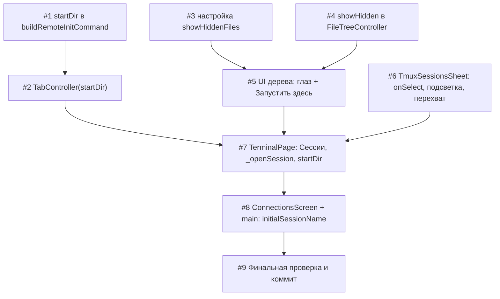

# План реализации: Выбор tmux-сессий, папка запуска и скрытые файлы (mobile)

## Обзор

Три независимые линии работ сходятся в `TerminalPage`:

- **A. Remote/domain** — `startDir` в команде запуска tmux и в `TabController`.
- **B. Дерево файлов** — `showHidden` (настройка + фильтр + переключатель) и пункт меню «Запустить tmux-сессию здесь».
- **C. Панель сессий** — `onSelect`, подсветка, диалог перехвата, неподдерживаемые имена.
- **D. Интеграция** — `TerminalPage` (кнопка «Сессии», `_openSession`, приём пути из дерева), `ConnectionsScreen` + `main.dart` (`initialSessionName`).

Линии A, B, C трогают непересекающиеся файлы и выполняются параллельно; D идёт после них. Все команды запускаются из `mobile/`, если не сказано иное.

## Задачи

### Блок 1 — основа, параллельно (нет взаимных зависимостей и общих файлов)

| # | Задача | Файлы | Зависит от | Режим выполнения | Проверка |
|---|--------|-------|------------|------------------|----------|
| 1 | `buildRemoteInitCommand(startDir)`: валидация (абсолютный путь, без NUL/CR/LF → `ArgumentError`), побайтовое кодирование UTF-8 в `printf '\ooo…'`, `-c "$d"` в tmux-ветке; при `null` вывод не меняется. Новые тесты: кодирование `'`, `!`, пробел, `$`, кириллица; инвариант L0; выполнение собранной команды в реальном `sh` (stub `tmux`, проверка `pwd`); при `persistence=off` `startDir` игнорируется или бросает (зафиксировать в тесте) | `lib/remote/remote_shell_hooks.dart`, `test/remote/remote_shell_hooks_start_dir_test.dart` (новый) | — | parallel-subagent | `flutter test test/golden/remote_shell_hooks_golden_test.dart test/remote/` + `node ../scripts/gen-remote-fixtures.mjs --check` (из корня репозитория) |
| 3 | Настройка скрытых файлов: `AppSettingsStore.getShowHiddenFiles/setShowHiddenFiles` (ключ `etty.settings.showHiddenFiles`), реализация в `SecureAppSettingsStore`, `showHiddenFilesProvider` (`AsyncNotifier<bool>`, образец `biometricLockEnabledProvider`); unit-тесты в существующем файле на фейковом `SecureKeyValueStore` | `lib/data/app_settings_store.dart`, `lib/app/providers/file_tree_providers.dart` (новый), `test/data/app_settings_store_test.dart` (дополнение существующего) | — | parallel-subagent | `flutter test test/data/` |
| 4 | `FileTreeController.showHidden` (по умолчанию `false`, сеттер с `notifyListeners`) + фильтр по `name.startsWith('.')` в обходе видимых узлов (`_visibleNodes()` в `FileTree`), корень не скрывается, состояние `expanded` не трогается; тесты контроллера/виджета | `lib/ui/files/file_tree_controller.dart`, `lib/ui/files/file_tree.dart`, `test/ui/files/file_tree_test.dart` | — | parallel-subagent | `flutter test test/ui/files/file_tree_test.dart` |
| 6 | `TmuxSessionsSheet`: параметр `onSelect(String)`, тап по плитке, усиленная подсветка `attached > 0` (фон + метка), диалог перехвата для активных, неактивная плитка + «имя не поддерживается» для имён вне `sessionNameRe`; rename/kill не выбирают строку; сохранить существующие `Key`; виджет-тесты | `lib/ui/connections/tmux_sessions_sheet.dart`, `test/ui/connections/tmux_sessions_sheet_test.dart` | — | parallel-subagent | `flutter test test/ui/connections/tmux_sessions_sheet_test.dart` |

### Блок 2 — зависит от блока 1 (по линиям)

| # | Задача | Файлы | Зависит от | Режим выполнения | Проверка |
|---|--------|-------|------------|------------------|----------|
| 2 | `TabController(startDir)`: необязательный параметр, передача в `buildRemoteInitCommand` в `_connect`; сохранение при авто-ретрае без хуков и переподключении; тесты (в т.ч. что `startDir` доходит до `ShellSession.start` и сохраняется при ретрае) | `lib/domain/tab_controller.dart`, `test/domain/tab_controller_test.dart` (+ пересборка `.mocks.dart`, если изменилась сигнатура мокаемого типа) | 1 | sequential | `flutter test test/domain/tab_controller_test.dart` |
| 5 | UI дерева: переключатель «глаз» в AppBar `RemoteFileTreeScreen` (читает/пишет `showHiddenFilesProvider`, прокидывает в `FileTree` → `controller.showHidden`); пункт меню папки/корня «Запустить tmux-сессию здесь» (колбэк `onStartSession(path)` у `FileTree`), `Navigator.pop(path)`; пункт скрыт при `persistence != 'tmux'`; виджет-тесты | `lib/ui/files/file_tree.dart`, `lib/ui/files/remote_file_tree_screen.dart`, `test/ui/files/file_tree_test.dart` | 3, 4 | sequential | `flutter test test/ui/files/` |

### Блок 3 — интеграция (строго последовательно)

| # | Задача | Файлы | Зависит от | Режим выполнения | Проверка |
|---|--------|-------|------------|------------------|----------|
| 7 | `TerminalPage`: параметр `initialSessionName`; кнопка «Сессии» в AppBar (скрыта при `persistence != 'tmux'`, открывает `TmuxSessionsSheet` на общем `SshConnection` без закрытия его при dismiss); `_openSession(name)` — переключение на существующую вкладку или новая `TabController(sessionName: name)`; приём `String?` из `RemoteFileTreeScreen` → вкладка с `startDir` и `pickFreeSessionName`; проброс `initialSessionName` в `main.dart` | `lib/ui/terminal/terminal_page.dart`, `lib/main.dart` | 2, 5, 6 | sequential | `flutter analyze` + `flutter test test/ui/terminal/` + ручной прогон в `flutter run` |
| 8 | `ConnectionsScreen`: выбор сессии из панели → `onOpen(profile, sessionName: …)` и закрытие панели; `main.dart` сохраняет `_openSessionName` и передаёт в `TerminalPage(initialSessionName)`; обновить `connections_screen_test.dart` | `lib/ui/connections/connections_screen.dart`, `lib/main.dart`, `test/ui/connections/connections_screen_test.dart` | 7 | sequential | `flutter test test/ui/connections/` |
| 9 | Финальная проверка: `flutter analyze`, `flutter test`, `node scripts/gen-remote-fixtures.mjs --check` (из корня), сборка APK (`scripts/run.sh mobile:apk`); ручной прогон критериев приёмки на телефоне (Tailscale-сервер `100.96.33.2:22`); обновить статус README → `Done`; коммит(ы) без упоминаний Claude | — | 8 | sequential | см. критерии приёмки в `spec.md` |

## Покрытие требований

| REQ | Задачи |
|-----|--------|
| REQ-1, REQ-2, REQ-3, REQ-4 | 6 |
| REQ-5, REQ-7 | 7 |
| REQ-6 | 8 (и 7: параметр `initialSessionName`) |
| REQ-8, REQ-9 | 1 |
| REQ-10 | 2 |
| REQ-11 | 5 (меню, `pop`), 7 (приём пути, создание вкладки) |
| REQ-12 | 4 |
| REQ-13 | 5 |
| REQ-14 | 3 (хранилище/провайдер), 5 (подключение к UI) |
| REQ-15 | 4 |

## Стратегия выполнения

1. **Старт — одновременно:** #1, #3, #4, #6 (`parallel-subagent`): файлы не пересекаются, зависимостей между ними нет.
2. **Затем по линиям:** #2 после #1; #5 после #3 и #4 (обе правят `file_tree.dart` — #5 стартует только когда #4 влит и проверен).
3. **Интеграция:** #7 после #2, #5, #6; затем #8, затем #9 — строго по цепочке (`terminal_page.dart` и `main.dart` общие для #7/#8).

## Ревью после каждого шага

- После каждой задачи — сверка с `plan.md` и `spec.md` (скоуп, критерии приёмки, соответствующие REQ).
- Проверка, что изменения не конфликтуют с параллельно выполняемыми задачами (общие файлы: `file_tree.dart` — #4/#5; `terminal_page.dart` и `main.dart` — #7/#8; `tab_controller_test.dart` — только #2).
- Если задачу делал субагент — основной агент проводит ревью результата (diff, `flutter analyze`, прогон тестов задачи) перед следующим шагом.
- Для #1 дополнительно: `node scripts/gen-remote-fixtures.mjs --check` и неизменность golden-фикстур (`git status test/fixtures` пуст).
- Перед #9: `git diff` не содержит случайных правок вне «Затронутых файлов» из `spec.md`.
- Правки `AndroidManifest.xml`/`scripts/run.sh`, лежащие в рабочей копии с прошлых задач, в коммиты этой фичи не включать.
