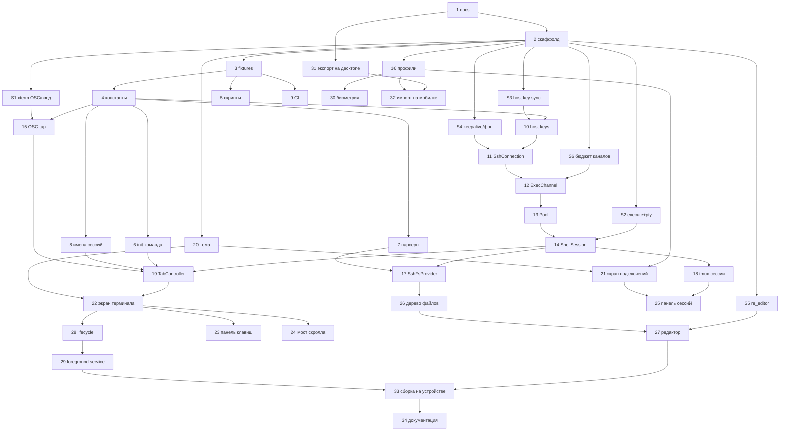

# eTty Mobile — Flutter-приложение с SSH/tmux

**Статус:** In Progress (Блок 0 + Блок 1 + Блок S + Блок 2 завершены: #1–#14, S1–S6; S2/S4
частично — tmux-реаттач и фон на реальном iOS остаются открытыми до устройства/разрешения)
**Ветка:** `feature/mobile-app` (базовая ветка для merge — `main`)
**Чеклист:** [checklist.md](./checklist.md)

## Context

Сейчас eTty — только десктоп (Electron 33). Самая ценная часть SSH-функционала — персистентные
tmux-сессии, переживающие разрыв связи, сон и перезапуск приложения — на телефоне нужна ещё
сильнее: мобильная сеть рвётся постоянно. Задача: мобильное приложение с тем же функционалом
подключения к удалённым серверам.

**Главный вызов.** Десктоп не использует ни одной SSH-библиотеки: он спавнит системный бинарник
`ssh` через `node-pty` и мультиплексирует служебные каналы через OpenSSH **ControlMaster**
(`src/main/ssh-command.js`, `src/main/ssh/ssh-control-channel.js`). На iOS/Android нет ни бинарника
`ssh`, ни ControlMaster. Значит мобильное приложение — **не порт кода, а вторая реализация одного
и того же удалённого протокола**: тот же генерируемый sh-текст, те же имена tmux-сессий, тот же
сокет `-L etty`, тот же `tmux.conf`.

Отсюда жёсткое требование: сервер не должен замечать разницы между клиентами. Десктоп догоняет
конфиг на уже работающий tmux-сервер через `source-file`; если телефон сгенерирует другой
`tmux.conf`, два клиента начнут перетирать конфиг одной и той же сессии. Поэтому генераторы
обязаны совпадать побайтово, и это удерживается golden-тестами, а не дисциплиной.

**Хорошая новость.** `dartssh2` даёт несколько параллельных каналов поверх одного TCP-соединения
(`shell` + `execute` + `sftp`) нативно — это прямая, более простая замена ControlMaster.

**Результат v1.** Flutter-приложение под iOS и Android в подкаталоге `mobile/`: SSH-вкладки,
персистентные tmux-сессии с панелью сессий сервера, удалённое дерево файлов, просмотр и правка
файлов с подсветкой.

---

## Решения, зафиксированные с пользователем

| Развилка | Решение |
|---|---|
| Платформы | iOS + Android одной кодовой базой |
| Стек | **Flutter / Dart** |
| Размещение | подкаталог **этого** репозитория — `mobile/` |
| Скоуп v1 | терминал + SSH-вкладки, персистентные tmux-сессии, удалённое дерево файлов, просмотр/правка файлов |
| Транспорт удалённой ФС | **те же POSIX sh-скрипты**, что на десктопе (не SFTP) |
| Консистентность tmux-контракта | **golden-тесты**: Node генерирует fixtures из JS, Dart сверяет побайтово |
| Профили подключений | ручной ввод + экспорт/импорт зашифрованным файлом с десктопа |
| Редактор | просмотр + правка с подсветкой (`re_editor`/`re_highlight`), без LSP |

---

## Требования

### Протокол (совместимость с десктопом)

- **REQ-1.** Имена tmux-сессий строятся тем же алгоритмом: `etty-<первые 8 alnum connectionId>`,
  при занятости `-2`/`-3`/… (`src/shared/ssh-session-name.js`), валидация по
  `SESSION_NAME_RE = /^[A-Za-z0-9_-]{1,64}$/`.
- **REQ-2.** Remote-команда для tmux-режима генерируется побайтово так же, как
  `buildRemoteInitCommand()` (`src/main/ssh/remote-shell-hooks.js`): та же трёхуровневая модель
  цитирования, тот же инвариант `assertL0Safe()` (в L1-тексте нет `'` и `!`), тот же `~/.cache/etty`,
  тот же генерируемый `tmux.conf`, тот же финальный
  `exec "$t" -u -L <socket> -f "$c/tmux.conf" new-session -A -D -s "<name>" "/bin/sh $c/init"`.
- **REQ-3.** Удалённая ФС работает теми же скриптами `src/main/ssh/remote-scripts.js` и теми же
  парсерами `remote-parse.js`, с тем же контрактом ошибок (exit 13 — traversal, 3 — not found,
  17 — имя занято) и тем же правилом «данные только позиционными `$1..$N`, без интерполяции в текст».
- **REQ-4.** Любое расхождение генераторов десктопа и мобилки ломает CI: Node-скрипт
  перегенерирует fixtures, `git diff --exit-code` падает.

### Соединение

- **REQ-5.** Одно `SSHClient`-соединение на `connectionId`; вкладки — shell-каналы, операции ФС и
  tmux — параллельные exec-каналы на том же соединении. Параллельные exec ограничены семафором
  (4, как `SSH_FS_CONFIG.MAX_CONCURRENT_EXEC` — sshd `MaxSessions` по умолчанию 10).
- **REQ-6.** Ref-counting и idle-dispose соединения (аналог `SshConnectionMaster`), single-flight
  подключения, cooldown после неудачной аутентификации (не долбить `MaxAuthTries`/fail2ban).
- **REQ-7.** Аутентификация: пароль, приватный ключ (в т.ч. с passphrase), keyboard-interactive.
  SSH-агента на мобилке нет — `authType:'agent'` при импорте помечается как неподдерживаемый.
- **REQ-8.** **Верификация host key.** На десктопе этим занимается OpenSSH через `known_hosts`;
  в `dartssh2` это обязанность приложения. TOFU: при первом подключении показать отпечаток и
  спросить; при несовпадении — жёсткая блокировка с предупреждением. Своё хранилище отпечатков.

### Терминал и tmux

- **REQ-9.** Множественные вкладки, каждая — свой shell-канал; переключение без разрыва.
- **REQ-10.** Персистентный режим (tmux) — **режим по умолчанию на мобилке** (на десктопе это
  переключатель). Обоснование: iOS рвёт сокеты в фоне, без tmux любое сворачивание убивает работу.
  Обычный SSH-режим остаётся доступен переключателем, как на десктопе.
- **REQ-11.** Свёртывание приложения — detach (закрыть канал), не kill. Возврат — переподключение
  и re-attach (`new-session -A -D`), затем ресинк cwd/busy одним запросом
  `TMUX_SESSION_STATE_SCRIPT` → `ssh:session-state`-эквивалент.
- **REQ-12.** `exitCode 0` на tmux-вкладке = сессию перехватил другой клиент → экран «перехвачено»
  с кнопкой вернуть. Быстрый ненулевой выход с хуками → один авто-ретрай без remote-команды
  (конфликт с `RemoteCommand`/`ForceCommand`), как на десктопе.
- **REQ-13.** OSC 7 (cwd), OSC 133 (busy), OSC 52 (clipboard) разбираются **до** записи в терминал,
  с развёрткой DCS-passthrough `\x1bPtmux;\x1b\x1b<payload>\x1b\\`.
- **REQ-14.** Скролл истории в tmux-вкладке: tmux работает с `mouse off`, scrollback живёт в tmux,
  поэтому вертикальный жест транслируется в `WHEEL_SCROLL_UP_SEQ`/`WHEEL_SCROLL_DOWN_SEQ`
  (`\x1b[1;8A` / `\x1b[1;8B`) — ровно как `terminal-wheel-handler.js` на десктопе.
- **REQ-15.** Панель сессий сервера: список (включая созданные не через eTty), kill, rename,
  автополлинг — через `TMUX_LIST_SESSIONS_SCRIPT` / `KILL` / `RENAME`.

### Мобильная специфика

- **REQ-16.** Панель модификаторов над клавиатурой: Esc, Tab, Ctrl (залипающий), Alt, стрелки,
  PgUp/PgDn, `|`, `-`, `~`, `/`, быстрые Ctrl+C/Ctrl+D/Ctrl+Z. Реализуется кастомным
  `TerminalInputHandler`.
- **REQ-17.** Выделение и копирование текста жестом (long-press), корректный safe area,
  корректный resize при появлении/скрытии клавиатуры (шлёт `resizeTerminal`).
- **REQ-18.** Секреты (пароли, passphrase, приватные ключи) — только в Keychain / Android Keystore
  через `flutter_secure_storage`; профили без секретов — обычный JSON в app support.
  Опциональная биометрическая блокировка приложения.
- **REQ-19.** Android: foreground service, чтобы соединение не убивалось сразу при сворачивании.
  iOS: корректный detach/reattach-цикл (фоновый сокет всё равно умрёт).

### Файлы

- **REQ-20.** Удалённое дерево: lazy-load, CRUD, polling-watcher раскрытых каталогов
  (3000 мс, батчи до 40 каталогов за exec, до 150 путей на операцию из-за ARG_MAX) — как
  `src/main/fs/ssh-fs-provider.js`.
- **REQ-21.** Просмотр и правка файла с подсветкой синтаксиса и сохранением на сервер
  (`WRITE_FILE_SCRIPT` — stdin → temp → `mv`, атомарно).

### Перенос профилей

- **REQ-22.** Десктоп умеет экспортировать подключения в зашифрованный файл `*.ettyx`:
  PBKDF2-HMAC-SHA256 (600 000 итераций) → AES-256-GCM, парольная фраза вводится пользователем.
  Приватные ключи включаются в экспорт только по явному чекбоксу (на телефоне `privateKeyPath`
  десктопа бессмыслен).
- **REQ-23.** Мобильное приложение импортирует этот файл (системный file picker / share sheet),
  секреты кладёт в secure storage.

### Ограничения (не входит в v1)

Git-панель, поиск по проекту, ИИ-агенты и quick replies, менеджер версий Node, темы из
пользовательских `themes/*.json`, история команд, порт-форвардинг, QR-передача профилей,
SSH-агент, двусторонняя синхронизация профилей, восстановление вкладок между запусками
(tmux-сессии и так живут на сервере).

---

## Архитектура

### Размещение

Репозиторий плоский: один `package.json`, без workspaces, `src/` — это Electron-приложение.
Поэтому Flutter-проект кладём в **`mobile/`** в корне — он ни во что не вмешивается,
`electron.vite.config.mjs` и `package.json.build.files` (`out/**`) его не видят.

```
mobile/                        — Flutter-приложение
  lib/
    core/config/               — константы (аналог src/renderer/core/config/)
      ssh_session_config.dart  ← порт src/shared/ssh-session-config.js
      ssh_fs_config.dart       ← порт src/shared/ssh-fs-config.js
      path_utils.dart          ← порт src/shared/path-utils.js
    remote/                    — «протокол eTty»: чистый Dart, без Flutter и без сети
      remote_scripts.dart      ← порт src/main/ssh/remote-scripts.js (константы)
      remote_parse.dart        ← порт src/main/ssh/remote-parse.js (чистые парсеры)
      remote_shell_hooks.dart  ← порт src/main/ssh/remote-shell-hooks.js
      session_name.dart        ← порт src/shared/ssh-session-name.js
      persistence.dart         ← порт src/shared/ssh-persistence.js
      posix_quote.dart         — цитирование argv
    transport/                 — dartssh2
      ssh_connection.dart      — один SSHClient на connectionId
      ssh_connection_pool.dart — реестр, refcount, idle-dispose (аналог SshConnectionMasterRegistry)
      exec_channel.dart        — exec() с семафором (аналог SshControlChannel)
      shell_session.dart       — execute() с PTY для вкладки (аналог PtyManager)
      host_keys.dart           — TOFU-верификация
    data/                      — connection_store, known_hosts_store, connection_export
    domain/                    — tab_controller, ssh_fs_provider, tmux_sessions, osc_tap
    ui/                        — terminal/, connections/, files/, editor/
  test/
    fixtures/remote/           — сгенерированные из JS, коммитятся
scripts/gen-remote-fixtures.mjs — генератор fixtures (каталог scripts/ уже существует)
.github/workflows/mobile.yml    — analyze + test + сверка fixtures на PR
```

### Замена ControlMaster

| Десктоп | Мобилка |
|---|---|
| `ssh -o ControlMaster=auto`, сокет в tmpdir | один `SSHClient` на `connectionId` |
| PTY-вкладка = отдельный процесс `ssh` | shell-канал: `client.execute(remoteInitCommand, pty: SSHPtyConfig(...))` |
| `SshControlChannel.exec()` по мультиплексу | `client.execute(cmd)` без PTY, семафор на 4 |
| `SshConnectionMaster` (`ssh -N`) для панели | тот же `SSHClient`, отдельный exec-канал |
| `SshSessionRegistry` по pid | `SshConnectionPool` по `connectionId` + сессии вкладок |
| `askpass.sh` + `SSH_ASKPASS` | `onPasswordRequest` / `identities` / `onUserInfoRequest` |
| known_hosts делает OpenSSH | `onVerifyHostKey` + своё TOFU-хранилище (**новый код**) |

Подтверждённые API `dartssh2` (Context7 + чтение исходников пакета + живой тест против
192.168.1.142, спайки S2/S3/S4/S6): `SSHSocket.connect`, `SSHClient(socket, username:,
identities:, onPasswordRequest:, onUserInfoRequest:, onVerifyHostKey:, keepAliveInterval:)`,
`await client.authenticated`, `client.shell({pty, environment})`,
`client.execute(cmd, {pty, environment})` → `SSHSession` (`.stdout`, `.stderr`, `.write()`,
`.done`, `.resizeTerminal(w,h)`), `SSHPtyConfig(type:, width:, height:)`. Дополнительно:

- `SSHHostkeyVerifyHandler = FutureOr<bool> Function(String type, Uint8List fingerprint)`,
  `SSHPasswordRequestHandler = FutureOr<String?> Function()`,
  `SSHUserInfoRequestHandler = FutureOr<List<String>?> Function(...)` — все три async-совместимы,
  реальный UI-диалог можно `await` прямо внутри колбэка (S3). `fingerprint` уже в формате OpenSSH
  `SHA256:<base64 без паддинга>` — свой хешинг для TOFU не нужен.
- `keepAliveInterval` (дефолт 10 с) + `SSHClient.done` (`Future<void>`, завершается на закрытии
  транспорта) — встроенный keepalive и сигнал обрыва, свой heartbeat-fallback не нужен (S4).
- `execute(cmd, pty:)` выделяет настоящий PTY (`/dev/pts/N`), `TERM`/размер доходят корректно,
  `resizeTerminal()` реально долетает до сервера (`stty size` меняется) — подтверждено на живом
  сервере (S2), эквивалент `ssh -tt host 'cmd'` для REQ-2.
- До ~8 параллельных `execute()` на одном `SSHClient` — стабильно и по-настоящему параллельно; у
  границы дефолтного `sshd` `MaxSessions=10` начинаются отказы (S6) — обосновывает стартовый
  лимит `ChannelSemaphore` в 4, как на десктопе.
- **Классификация сетевых ошибок (задача #11, проверено на loopback и живом сервере):**
  `SSHSocket.connect()` на отказ TCP-уровня (connection refused / timeout / DNS lookup failed)
  бросает `dart:io`-й `SocketException` НАПРЯМУЮ, а не `SSHSocketError` из dartssh2 — та
  оборачивает только ошибки сокета ПОСЛЕ установления соединения. `SshConnection._classify()`
  матчит по `SocketException.message` (текст), не по `osError.errorCode` — errno-коды
  платформозависимы (Linux/macOS/iOS/Android дают разные числа для одной причины), текст
  сообщения Dart нормализует одинаково.

### State management — Riverpod

Архитектурные инварианты проекта ложатся на Riverpod один в один: провайдер = DI-контейнер,
`Notifier`/`AsyncNotifier` = StateStore, `ref.onDispose` = обязательный `destroy()`,
`Stream`-провайдер = EventBus. Bloc добавил бы церемонию без выигрыша. Константы — в
`lib/core/config/`, как `src/renderer/core/config/` на десктопе.

### OSC: `osc_tap.dart` — не опция, а обязательный перехват до терминала

Подтверждено чтением исходников `xterm.dart` (спайк S1, см. «Результаты спайков»): OSC 7/133/52
доходят до `onPrivateOSC` (только OSC 0/1/2 обрабатываются отдельно), но **DCS-passthrough
(`\x1bPtmux;\x1b\x1b…\x1b\\`) парсер не поддерживает вообще** — неизвестный esc-код молча
поглощается, а байты полезной нагрузки печатаются на экран как обычный текст. Без перехвата ДО
`terminal.write()` любая tmux-вкладка показывала бы видимый мусор при каждом промпте. Поэтому
`osc_tap.dart` — трансформер потока, который разворачивает DCS-обёртку, вынимает OSC 7/133/52 и
отдаёт остаток в `terminal.write()` — обязательная часть архитектуры, не подстраховка.

Также подтверждено (S1): ввод с софт-клавиатуры (`CustomTextEdit` → `_onInsert` →
`terminal.textInput()`) идёт в `onOutput` напрямую, минуя `inputHandler`/`TerminalInputHandler`
полностью. Значит залипающий Ctrl/Alt (REQ-16) реализуется ТОЛЬКО через перехват на уровне
`onOutput` (`domain/terminal/output_interceptor.dart`, задача #36 в детальной декомпозиции блока
3/4) — печатный ASCII-символ при активном sticky-Ctrl заменяется на `char & 0x1f` до отправки в
SSH-канал; кастомный `TerminalInputHandler` остаётся рабочим только для физической клавиатуры
(iPad + внешняя клавиатура), но не для экранной панели модификаторов.

### Golden-тесты

`scripts/gen-remote-fixtures.mjs` (реализован в задаче #3) импортирует реальные модули десктопа
и пишет в `mobile/test/fixtures/remote/`:

- `scripts.json` — все экспортируемые константы-скрипты из `remote-scripts.js`;
- `config.json` — снимок `SSH_SESSION_CONFIG`, `SSH_FS_CONFIG` и `SSH_FS_BATCH_SIZE` (последнее —
  захардкоженное дублирование внутренней `BATCH_SIZE` из `ssh-fs-provider.js`, она не
  экспортируется; при её изменении на десктопе генератор нужно поправить вручную — это
  единственное значение фикстур, не читаемое напрямую из исходника, см. риск R10);
- `path-utils.json` — вывод `createPathUtils('/')` (SSH-путь всегда POSIX) для join/dirname/
  basename/extname/normalize/isInside;
- `init-command/cases.json` + `init-command/<case>.txt` — вывод `buildRemoteInitCommand()` на
  матрице `persistence` {off, tmux} × `hooks` {true, false} × `socketName` {`etty`, `''`,
  кастомный} × валидные/невалидные `sessionName`; для невалидных кейсов `cases.json` хранит
  `expectThrow: true` и текст ошибки (текст — информативно, Dart обязан бросить исключение, но
  не обязан повторять формулировку);
- `session-names.json`, `persistence.json` — вывод `buildSessionNameBase`/`pickFreeSessionName`/
  `resolveSshPersistence`;
- `parse/<name>.json` — массив `{name, inputBase64, ...доп. аргументы парсера, expected}` для
  каждого парсера из `remote-parse.js` (`parsePollMtimes` — `expected` как массив `[key, value]`
  пар вместо `Map`, для стабильной JSON-сериализации).

Проверено: `node scripts/gen-remote-fixtures.mjs --check` ловит порчу файла (exit 1) и подтверждает
чистое состояние после регенерации (exit 0); прогон всех четырёх `src/main/__tests__/*.test.mjs`
после появления генератора — без регрессий.

Dart-тесты сверяют свой вывод с fixtures побайтово. CI (`.github/workflows/mobile.yml`, на PR):
перегенерировать fixtures → `git diff --exit-code mobile/test/fixtures` → `flutter analyze` →
`flutter test`. Правка десктопного генератора без правки Dart валит сборку — это и есть механизм
удержания REQ-4. Отдельно стоит добавить в тот же workflow отсутствующий сейчас прогон
существующих `src/main/__tests__/*.test.mjs` (в проекте нет `npm test`, CI только релизный).

### Зависимости Flutter

`dartssh2`, `xterm`, `flutter_riverpod`, `flutter_secure_storage`, `local_auth`, `re_editor`,
`re_highlight`, `cryptography` (PBKDF2 + AES-GCM), `path_provider`, `file_picker`, `share_plus`.

Dev-зависимости: `mockito` + `build_runner` (добавлены в задаче #12, по скиллу
`dart-generate-test-mocks` из `mobile/.agents/skills/`) — мокают `SSHClient`/`SSHSession` для
изоляции транспортных тестов от сети. Требуют интерфейсов-«швов» на стороне продакшен-кода
(`transport/ssh_connection.dart`): `SshClientSource` (`ExecChannel`/`ShellSession` зависят от
него, а не от конкретного `SshConnection`) и `PoolableConnection` (`SshConnectionPool`, задача
#13, зависит от него — тесты пула подставляют детерминированный фейк вместо реального сетевого
`connect()`, тайминги настоящей сети не годятся для проверки refcount/single-flight). Оба
интерфейса реализует один класс — `SshConnection`. Сгенерированные `*.mocks.dart` коммитятся в
репозиторий (обычная практика для mockito — не требует шага `build_runner build` в CI).

---

## План реализации

Режимы: `sequential` — строго по цепочке; `parallel-subagent` — можно отдать параллельному
субагенту; `parallel-same` — параллельно в одной сессии.

### Блок S — Спайки (после #2, все параллельны, до блока 2)

Архитектурный проход вскрыл допущения, которые дешевле проверить на выброшенном прототипе, чем
заложить в архитектуру транспорта и потом переписывать. Блок 2 не начинается, пока не закрыты
S1–S4 (S5, S6 не блокируют транспорт, но блокируют соответствующие задачи ниже).

| # | Задача | Файлы | Зависит от | Режим | Проверка |
|---|--------|-------|------------|-------|----------|
| S1 | Спайк: перехват ввода/вывода в `xterm.dart` — доходят ли OSC 7/133 до `onPrivateOSC`, срабатывает ли кастомный `TerminalInputHandler` для символов с софт-клавиатуры (для sticky-Ctrl) | `mobile/spikes/` (не мержится) | 2 | parallel-subagent | **Закрыт** — см. «Результаты спайков» |
| S2 | Спайк: `client.execute(remoteInitCommand, pty: SSHPtyConfig(...))` против реального sshd — эквивалентно ли это `ssh -tt host 'cmd'` | `mobile/spikes/` | 2 | parallel-subagent | **Закрыт для не-tmux сценария** (проверено на живом сервере); tmux-реаттач не проверялся — требует персистентной сессии на чужом сервере, отдельное разрешение |
| S3 | Спайк: сигнатура `onVerifyHostKey`/`onPasswordRequest` (sync или async) | `mobile/spikes/` | 2 | parallel-subagent | **Закрыт** — см. «Результаты спайков» |
| S4 | Спайк: keepalive в `dartssh2` + сколько живёт TCP-сокет в фоне на iOS | `mobile/spikes/` | 2 | parallel-subagent | **Частично закрыт**: сторона `dartssh2` подтверждена; время жизни сокета на реальном iOS в фоне — нужен реальный девайс, остаётся открытым |
| S5 | Спайк: `re_editor`/`re_highlight` на файле ~1 МБ — приемлемая латентность ввода | `mobile/spikes/` | 2 | parallel-subagent | **Закрыт** — см. «Результаты спайков» |
| S6 | Спайк: реальный бюджет параллельных каналов одного `SSHClient` относительно `MaxSessions` сервера | `mobile/spikes/` | 2 | parallel-subagent | **Закрыт** (эмпирика + чтение `sshd_config` на тестовом сервере) — см. «Результаты спайков» |

### Результаты спайков

Проверено 2026-09-22: офлайн — чтением исходников `dartssh2`/`xterm.dart` из pub cache и
`flutter test`; S2/S6 — на тестовом сервере пользователя (`SSH_HOST=192.168.1.142`,
ключевая аутентификация `~/.ssh/id_ed25519`, только read-only команды через `execute()`,
без `buildRemoteInitCommand`/tmux/записи файлов — по явному условию пользователя). Спайк-код
в `mobile/spikes/` не мержится (гитигнорен), доказательная база — вывод команд ниже.

**S1 — `xterm.dart` (закрыт, два важных вывода меняют статус решений с «дефолт» на «обязательно»).**
1. OSC 7/133/52 подтверждённо доходят до `onPrivateOSC`: в `_escHandleOSC()` (`core/escape/parser.dart`)
   отдельно обрабатываются только OSC `0`/`1`/`2` (title/icon), всё остальное идёт в
   `handler.unknownOSC(ps, pt)` → `onPrivateOSC(ps, pt)`, `pt` уже разбит по `;`. Поддержаны оба
   терминатора (BEL и ST).
2. **DCS-passthrough (`\033Ptmux;...\033\\`) парсер НЕ поддерживает вообще** — `_escHandlers` не
   содержит записи для `P`; неизвестный esc-код уходит в `unkownEscape()` (no-op), а byte-поток
   payload'а дальше проходит через `_processChar()` как обычные печатные символы — то есть **будет
   напечатан на экране как видимый мусор** при каждом промпте в tmux-режиме, если не перехватить
   ДО `terminal.write()`. Это переводит `osc_tap.dart` из «защитного дефолта» в жёсткое
   обязательное требование — без него любая tmux-вкладка нечитаема.
3. Ввод с софт-клавиатуры идёт `CustomTextEdit.updateEditingValue()` → `_onInsert()` →
   `terminal.textInput(text)` → `onOutput` **напрямую, минуя `inputHandler` полностью**.
   `inputHandler` вызывается только из `keyInput()` (распознанные аппаратные клавиши), а
   `_onInsert` вызывает `keyInput()` без модификаторов (`ctrl`/`alt` не передаются). Значит
   залипающий Ctrl (REQ-16) **не может** быть реализован через `TerminalInputHandler` для
   софт-клавиатуры — единственный рабочий путь: перехват на уровне `onOutput`
   (`TerminalOutputInterceptor`, уже заложен в архитектуре как план Б в риске R6) — теперь это
   единственная и обязательная реализация, а не резерв на случай проблем.

**S2 — `execute()+pty` против реального sshd (закрыт для non-tmux сценария).**
```
$ tty; echo "TERM=$TERM"; echo "FLAGS=$-"; stty size   # pty: 100x30
/dev/pts/1
TERM=xterm-256color
FLAGS=hBc
30 100
```
Реальный PTY выделяется (`/dev/pts/1`, не «not a tty»), `$TERM` доходит как задано, `stty size`
подтверждает запрошенный размер. `resizeTerminal(120,40)`, вызванный после старта с 80×24, дал
`stty size` → `40 120` при повторном опросе — SIGWINCH-эквивалент реально доходит до сервера.
Отсутствие `i` в `$-` — ожидаемо: `execute(cmd)` эквивалентно `ssh -tt host 'cmd'`, где `cmd` —
не пустая строка, и внешняя оболочка тоже невходит в интерактивный режим сама по себе (это же
верно и для десктопного `ssh -tt`); внутренний `exec "$s" -l` в `buildRemoteInitCommand()` уже
сам запускает настоящий интерактивный login-shell поверх этого PTY. Вывод: `execute()+pty` —
достаточная замена `ssh -tt` для REQ-2, план Б (через `client.shell()` + ручной `exec`-префикс)
не нужен. Реаттач к персистентной tmux-сессии (`-A -D`) не проверялся на этом сервере — создание
tmux-сессии и файлов в `~/.cache/etty` это уже изменение состояния сервера, требует отдельного
разрешения пользователя перед следующей попыткой.

**S3 — сигнатуры `dartssh2` (закрыт, отменяет план Б из рисков R3/R12).**
Все три колбэка асинхронны:
```dart
typedef SSHHostkeyVerifyHandler = FutureOr<bool> Function(String type, Uint8List fingerprint);
typedef SSHPasswordRequestHandler = FutureOr<String?> Function();
typedef SSHUserInfoRequestHandler = FutureOr<List<String>?> Function(SSHUserInfoRequest);
```
Можно показать настоящий UI-диалог и `await` ответ пользователя прямо внутри колбэка — план Б
(pre-flight-коннект на этапе сохранения профиля из риска R3) не нужен, отменяется. Бонус:
библиотека сама считает фингерпринт в формате OpenSSH `SHA256:<base64 без паддинга>` — TOFU-код
не должен реализовывать хеширование самостоятельно, только хранить/сравнивать готовую строку.

**S4 — keepalive в `dartssh2` (частично закрыт).**
`SSHClient(keepAliveInterval: Duration(seconds: 10))` (дефолт) — встроенный периодический ping,
плюс `SSHClient.done` — `Future<void>`, завершается при закрытии транспорта. Собственный
heartbeat-fallback из риска R4 не нужен на стороне `dartssh2`. Время жизни TCP-сокета в фоне на
реальном iOS-устройстве спайком не проверялось (нужен реальный девайс/TestFlight) — остаётся
открытым, закрывается в задаче #28.

**S5 — `re_editor` на файле ~1 МБ (закрыт, числа).**
Синтетический файл 1 048 618 байт / 13 059 строк, `flutter test` (без GPU, программный рендер —
числа хуже, чем будут на реальном устройстве):
- `CodeLineEditingController.fromText()` — 74 мс
- первый `pumpWidget` (build+layout+paint первого кадра) — 737 мс
- переход к последней строке — 52 мс, деградации от размера файла не видно (похоже на
  построчную виртуализацию, не полный ре-парс)

Решение для задачи #27: показывать индикатор загрузки на открытии, использовать
`CodeLineEditingController.fromTextAsync` (есть в API пакета) вместо синхронного `fromText` для
файлов, близких к лимиту.

**S6 — бюджет параллельных exec-каналов (закрыт).**
На тестовом сервере — read-only чтение `sshd_config`/`sshd_config.d/*.conf`: явного
`MaxSessions`/`MaxStartups` нет, действует дефолт OpenSSH (`MaxSessions 10`). Эмпирика (один
`SSHClient`, параллельные `execute()` с тривиальной командой):
```
N=2  успешно 2/2  за 428 мс
N=4  успешно 4/4  за 366 мс
N=6  успешно 6/6  за 370 мс
N=8  успешно 8/8  за 370 мс
N=10 успешно 9/10 за 378 мс   ← первая осечка, ровно на границе дефолтного MaxSessions=10
```
Совпадает с ожиданием: до 8 каналов — стабильно и по-настоящему параллельно (несколько
`sleep 0.3` укладываются в ~370 мс, не в 8×370 мс — значит не последовательно), у границы 10
начинаются отказы. Формула `ChannelSemaphore` (`clamp(1, SESSION_BUDGET − openShellChannels,
MAX_CONCURRENT_EXEC)`) подтверждена: дефолтное значение 4 (как на десктопе) даёт комфортный запас
относительно наблюдаемой границы ~9–10 на типичном сервере с дефолтным `sshd_config`.

### Блок 0 — Подготовка (последовательно)

| # | Задача | Файлы | Зависит от | Режим | Проверка |
|---|--------|-------|------------|-------|----------|
| 1 | Записать план и чеклист выполнения, создать ветку `feature/mobile-app` | `docs/plans/mob/plan.md`, `docs/plans/mob/checklist.md` | — | sequential | файлы на месте (`git add -f` — `docs/` в `.gitignore`) |
| 2 | Скаффолд Flutter-проекта: `flutter create`, bundle id `com.etty.mobile`, зависимости из списка выше, `mobile/.gitignore`, `mobile/README.md` с командами запуска | `mobile/pubspec.yaml`, `mobile/.gitignore`, `mobile/README.md` | 1 | sequential | `cd mobile && flutter analyze` |

### Блок 1 — Протокол и golden-тесты (после #2; внутри блока — параллельно)

| # | Задача | Файлы | Зависит от | Режим | Проверка |
|---|--------|-------|------------|-------|----------|
| 3 | Генератор fixtures на Node + первый прогон | `scripts/gen-remote-fixtures.mjs`, `mobile/test/fixtures/remote/*` | 2 | sequential | `node scripts/gen-remote-fixtures.mjs` создаёт непустые fixtures |
| 4 | Порт констант и path-утилит | `mobile/lib/core/config/{ssh_session_config,ssh_fs_config,path_utils}.dart` | 3 | parallel-subagent | `flutter test` на unit-тестах path_utils |
| 5 | Порт скриптов + golden | `mobile/lib/remote/remote_scripts.dart`, `mobile/test/remote_scripts_golden_test.dart` | 3 | parallel-subagent | golden совпадает со `scripts.json` |
| 6 | Порт `buildRemoteInitCommand` + цитирование + golden (**самая тонкая задача блока**: инвариант L0, отсутствие `'` и `!`) | `mobile/lib/remote/{remote_shell_hooks,posix_quote}.dart`, `mobile/test/remote_shell_hooks_golden_test.dart` | 3, 4 | parallel-subagent | побайтовое совпадение со всеми `init-command/*.txt` |
| 7 | Порт парсеров + golden | `mobile/lib/remote/remote_parse.dart`, `mobile/test/remote_parse_golden_test.dart` | 3, 4 | parallel-subagent | все `parse/*.json` проходят |
| 8 | Порт имён сессий и резолва режима + golden | `mobile/lib/remote/{session_name,persistence}.dart`, тест | 3, 4 | parallel-subagent | golden проходит |
| 9 | CI workflow: сверка fixtures, `flutter analyze`, `flutter test`, прогон `src/main/__tests__/*.test.mjs` | `.github/workflows/mobile.yml` | 3 | parallel-subagent | workflow зелёный на PR |

### Блок 2 — Транспорт (последовательно, после блока 1 **и** S1–S4)

Если S3 покажет, что `onVerifyHostKey`/`onPasswordRequest` синхронны, задача 11 реализуется через
pre-flight-коннект (снять отпечаток/спросить пароль до основного подключения), а не через диалог
изнутри callback — это меняет реализацию, но не публичный контракт `SshConnection`.

| # | Задача | Файлы | Зависит от | Режим | Проверка |
|---|--------|-------|------------|-------|----------|
| 10 | TOFU host keys: хранилище отпечатков + верификатор | `mobile/lib/transport/host_keys.dart`, `mobile/lib/data/known_hosts_store.dart` | 4, S3 | sequential | unit: новый/совпавший/изменившийся ключ; фингерпринт `SHA256:...` совпадает с `ssh-keygen -lf` |
| 11 | `SshConnection`: SSHClient, auth (пароль/ключ/passphrase/keyboard-interactive), `onVerifyHostKey`, keepalive (встроенный либо fallback-heartbeat из S4) | `mobile/lib/transport/ssh_connection.dart` | 10, S4 | sequential | ручное подключение к реальному серверу |
| 12 | `ExecChannel`: exec с семафором (динамический лимит по формуле из S6, старт 4), timeout, maxBuffer, stdin | `mobile/lib/transport/exec_channel.dart` | 11, S6 | sequential | `PROBE_SCRIPT` возвращает корректный parseProbe |
| 13 | `SshConnectionPool`: refcount, single-flight, idle-dispose, failure cooldown | `mobile/lib/transport/ssh_connection_pool.dart` | 12 | sequential | unit на счётчиках + ручная проверка |
| 14 | `ShellSession`: `execute()` c PTY (или `shell()` + явный `exec`-префикс, если S2 покажет расхождение с `ssh -tt`), resize, `done`/exitCode, поток вывода | `mobile/lib/transport/shell_session.dart` | 13, S2 | sequential | вывод `ls` приходит в поток; tmux-реаттач работает как в S2 |

### Блок 3 — Домен и данные (после #14, частично параллельно)

| # | Задача | Файлы | Зависит от | Режим | Проверка |
|---|--------|-------|------------|-------|----------|
| 15 | OSC-tap: DCS-passthrough + OSC 7/133/52 | `mobile/lib/domain/osc_tap.dart`, тест | 4 | parallel-subagent | unit на склейке по границам чанков |
| 16 | Хранилище профилей: JSON + секреты в secure storage | `mobile/lib/data/connection_store.dart` | 2 | parallel-subagent | CRUD, секрет не в JSON |
| 17 | `SshFsProvider`: CRUD, батчи 150, polling-watcher 3 с до 40 каталогов | `mobile/lib/domain/ssh_fs_provider.dart` | 14, 7 | sequential | CRUD на реальном сервере, traversal даёт exit 13 |
| 18 | tmux-сессии: list/kill/rename + автополлинг | `mobile/lib/domain/tmux_sessions.dart` | 14, 7 | parallel-subagent | список совпадает с `tmux -L etty ls` |
| 19 | `TabController`: создание вкладки, выбор имени сессии, режим, lifecycle, re-attach, `exitCode 0` = перехват, авто-ретрай без хуков | `mobile/lib/domain/tab_controller.dart` | 14, 6, 8, 15 | sequential | сессия видна на сервере, перехват детектится |

### Блок 4 — UI (после #19; большая часть параллельна)

| # | Задача | Файлы | Зависит от | Режим | Проверка |
|---|--------|-------|------------|-------|----------|
| 20 | Тема: порт палитр из `src/renderer/themes.js` в `ColorScheme` + `TerminalTheme`, Roboto | `mobile/lib/app/theme/*` | 2 | parallel-subagent | визуальная сверка с десктопом |
| 21 | Экран подключений: список, CRUD, сегмент SSH \| tmux | `mobile/lib/ui/connections/*` | 16, 20 | parallel-subagent | добавить/изменить/удалить профиль |
| 22 | Экран терминала: `TerminalView`, полоса вкладок, resize под клавиатуру | `mobile/lib/ui/terminal/terminal_page.dart`, `tab_strip.dart` | 19, 20 | sequential | ввод и вывод работают, resize корректный |
| 23 | Панель модификаторов + залипающий Ctrl (`TerminalInputHandler`) | `mobile/lib/ui/terminal/key_bar.dart`, `input_handler.dart` | 22 | parallel-subagent | Ctrl+C прерывает, стрелки листают историю |
| 24 | Мост скролла: жест → `WHEEL_SCROLL_*_SEQ` в tmux-режиме, нативный скролл в обычном | `mobile/lib/ui/terminal/scroll_bridge.dart` | 22 | parallel-subagent | скролл поднимает реальную историю tmux |
| 25 | Панель сессий сервера: список, kill, rename | `mobile/lib/ui/connections/tmux_sessions_sheet.dart` | 18, 21 | parallel-subagent | kill/rename отражаются на сервере |
| 26 | Дерево удалённых файлов: lazy-load, CRUD, контекстное меню | `mobile/lib/ui/files/*` | 17, 20 | parallel-subagent | полный CRUD с устройства |
| 27 | Просмотр/правка файла: `re_editor` + подсветка + сохранение | `mobile/lib/ui/editor/*` | 26 | sequential | правка сохраняется на сервер |

### Блок 5 — Мобильная специфика (после #22)

| # | Задача | Файлы | Зависит от | Режим | Проверка |
|---|--------|-------|------------|-------|----------|
| 28 | Жизненный цикл: detach при `paused`, reattach при `resumed`, ресинк через `TMUX_SESSION_STATE_SCRIPT` | `mobile/lib/domain/lifecycle_controller.dart` | 22 | sequential | 5 минут в фоне → возврат → сессия жива, cwd/busy верны |
| 29 | Android foreground service + iOS background-политика | `mobile/android/**`, `mobile/lib/platform/*` | 28 | parallel-subagent | соединение переживает короткое сворачивание на Android |
| 30 | Биометрическая блокировка (`local_auth`), опция в настройках | `mobile/lib/ui/settings/*` | 16 | parallel-subagent | вход по Face ID/отпечатку |

### Блок 6 — Перенос профилей (независим от блоков 2–5, можно начинать рано)

| # | Задача | Файлы | Зависит от | Режим | Проверка |
|---|--------|-------|------------|-------|----------|
| 31 | Десктоп: экспорт/импорт `*.ettyx` (PBKDF2-600k + AES-256-GCM), новые каналы в `IPC_CHANNELS`, кнопка в панели SSH; опциональное включение приватных ключей | `src/shared/ipc-channels.js`, `src/main/ipc-handlers/ssh-handlers.js`, `src/main/ssh-store.js`, `src/renderer/features/ssh/ssh-panel.js` | 1 | parallel-subagent | `npm run build`, экспорт открывается импортом обратно |
| 32 | Мобилка: импорт `*.ettyx` через file picker, раскладка секретов в secure storage | `mobile/lib/data/connection_export.dart`, UI импорта | 16, 31 | sequential | профиль с десктопа подключается с телефона |

### Блок 7 — Финализация

| # | Задача | Файлы | Зависит от | Режим | Проверка |
|---|--------|-------|------------|-------|----------|
| 33 | Иконка, splash, сборка debug-билда на реальном устройстве обеих платформ | `mobile/ios/**`, `mobile/android/**` | 27, 29 | sequential | приложение ставится и работает на телефоне |
| 34 | Документация: раздел про `mobile/` в `.agents/rules/project-rules.md`, запись в `CHANGELOG.md` | `.agents/rules/project-rules.md`, `CHANGELOG.md`, `docs/plans/mob/checklist.md` | 33 | sequential | ревью документа |

### Стратегия выполнения

Цепочка критического пути: **1 → 2 → S2 → 3 → 6 → 14 → 19 → 22 → 28 → 33 → 34**.

- Блок S (S1–S6) — сразу после скаффолда, все спайки параллельны друг другу и блоку 1.
  Каждый — выброшенный прототип, результат — решение/поправка в задаче ниже, код спайка не мержится.
- Блок 1 после #3 распараллеливается почти целиком (#4–#9): это независимые чистые Dart-модули
  с собственными golden-тестами. #6 самая рискованная — её лучше не отдавать вместе с другими.
- Блок 2 не стартует, пока не закрыты S1–S4 (см. заголовок блока); внутри блока — строго
  последовательный: каждый слой транспорта стоит на предыдущем.
- #15 и #16 не зависят от транспорта и могут делаться параллельно блоку 2.
- Блок 6 (#31) трогает только JS-код десктопа — не пересекается ни с одной Flutter-задачей,
  его можно отдать отдельному субагенту сразу после #1.
- Блок 4 распараллеливается после #22 — задачи трогают разные файлы UI.



### Ревью после каждого шага

- После каждой задачи — сверка со спецификацией и планом (скоуп, критерии приёмки).
- Проверка, что изменения не конфликтуют с параллельно выполняемыми задачами (общие файлы,
  противоречивая логика).
- Если задачу делал субагент — основной агент проводит ревью результата перед следующим шагом.
- Для задач блока 1 ревью обязательно включает прогон golden-тестов.

---

## Риски и спайки

| Риск | Статус |
|---|---|
| `onPrivateOSC` в `xterm.dart` может не отдавать OSC 7/133; DCS-passthrough tmux может не парситься | **Закрыт (S1).** OSC 7/133/52 доходят; DCS **не парсится вообще** и без перехвата печатался бы как мусор на экране — `osc_tap.dart` обязателен, не опция. |
| `client.execute(cmd, pty:)` может не быть полным эквивалентом `ssh -tt host 'cmd'` | **Закрыт для non-tmux (S2)**, живой сервер: PTY выделяется, `TERM`/размер/`resizeTerminal` доходят корректно. Реаттач к персистентной tmux-сессии не проверялся — создание сессии/файлов на чужом сервере требует отдельного разрешения. |
| `onVerifyHostKey`/`onPasswordRequest` могут быть синхронными — тогда модалку внутри колбэка не показать | **Закрыт (S3).** Все три колбэка `FutureOr` — async, реальный UI-диалог `await`-ится напрямую. Bonus: фингерпринт уже в формате `SHA256:<base64>`. План Б (pre-flight-коннект) отменён. |
| Нет встроенного keepalive; неизвестно, как детектится обрыв и сколько живёт TCP в фоне на iOS | **Частично закрыт (S4).** `keepAliveInterval` (дефолт 10 с) + `SSHClient.done` встроены — свой heartbeat не нужен. Время жизни сокета в фоне на реальном iOS — открыто, закрывается в #28 на устройстве. |
| Лимит `MaxSessions` сервера при множестве вкладок + exec-каналов, конкурирующих за один `SSHClient` | **Закрыт (S6)**, живой сервер: дефолтный `MaxSessions=10` (нет override в `sshd_config`), до 8 параллельных каналов — стабильно; `ChannelSemaphore` со стартовым лимитом 4 (как на десктопе) подтверждён с запасом. Формула `effectiveLimit = clamp(1, SESSION_BUDGET − openShellChannels, MAX_CONCURRENT_EXEC)` остаётся в силе для динамической коррекции. |
| Побайтовое совпадение `buildRemoteInitCommand` — самая вероятная точка расхождения, включая экранирование `\`/`\$`/`` \` `` в `printfToFile` | **Закрыт для десктопной сверки (#6)**: 13/13 golden-кейсов совпали побайтово, включая полную tmux-ветку. Остаётся открытым: реаттач на РЕАЛЬНОМ сервере (см. S2 выше). |
| `re_editor` — относительно молодой пакет, возможны проблемы с большими файлами | **Закрыт (S5).** 1 МБ/13059 строк: конструирование 74 мс, первый кадр 737 мс (без GPU), скролл в конец 52 мс, деградации нет. Решение для #27: `fromTextAsync` + индикатор загрузки. |
| iOS может убивать соединение агрессивнее ожидаемого | Открыт — нужен реальный девайс (см. S4). #28 (grace-таймер, детач/реаттач) проверяется на устройстве с разными интервалами фона. |
| Реаттач tmux может дать дублирование/сдвиг содержимого на экране (десктоп с этим почти не сталкивался — там `-A -D` редкое событие, а не штатный цикл сворачивания) | Открыт — требует персистентной сессии на реальном сервере (см. S2). В #28/#19: перед реаттачем полный clear локального буфера (`\x1b[H\x1b[2J\x1b[3J`), опора на историю tmux (`history-limit 10000`), не на локальный scrollback. |
| Экспорт приватных ключей в файл — чувствительная операция | Не спайк, решение архитектурное: явный opt-in чекбокс, предупреждение в UI, файл всегда зашифрован парольной фразой (#31). Рекомендуемый путь в UI — генерировать ключ прямо на телефоне и предлагать `ssh-copy-id`, чтобы приватный ключ вообще не покидал Keystore/Keychain. |
| Политики App Store (2.5.2/4.7) к приложениям, исполняющим удалённый код | Не спайк. Прецеденты есть (Termius, Blink, Prompt) — позиционировать явно как SSH-клиент. Проверить на TestFlight до полировки UI (в рамках #33). |

---

## Проверка (end-to-end)

**Совместимость протокола (главное):**
1. `node scripts/gen-remote-fixtures.mjs && git diff --exit-code mobile/test/fixtures` — чисто.
2. `cd mobile && flutter analyze && flutter test` — зелено, включая все golden.

**На реальном сервере, с телефона:**
3. Создать tmux-вкладку → на сервере `tmux -L etty ls` показывает сессию `etty-<8 alnum>`.
4. Открыть ту же сессию с десктопного eTty → на телефоне появляется экран «перехвачено»;
   вернуть на телефон → десктоп показывает своё «перехвачено». Конфиг сессии не ломается
   (проверить `tmux -L etty show-options -g | grep -E 'mouse|prefix|allow-passthrough'`).
5. Свернуть приложение на 5 минут, вернуться — сессия жива, cwd и индикатор занятости
   ресинкнулись, история доступна скроллом.
6. Дерево файлов: создать/переименовать/скопировать/удалить файл и каталог с пробелами и
   кириллицей в имени; попытка выйти за корень сессии отклоняется.
7. Открыть файл в редакторе, изменить, сохранить → изменения видны на сервере.
8. Экспортировать подключения с десктопа, импортировать на телефон, подключиться по
   импортированному профилю (отдельно — с паролем и с ключом).
9. Проверить незнакомый и подменённый host key: первый спрашивает подтверждение, второй блокирует.

**Регрессия десктопа:**
10. `npm run build` без ошибок; прогнать все четыре `node src/main/__tests__/*.test.mjs`;
    вручную проверить, что SSH- и tmux-вкладки десктопа работают как раньше.
